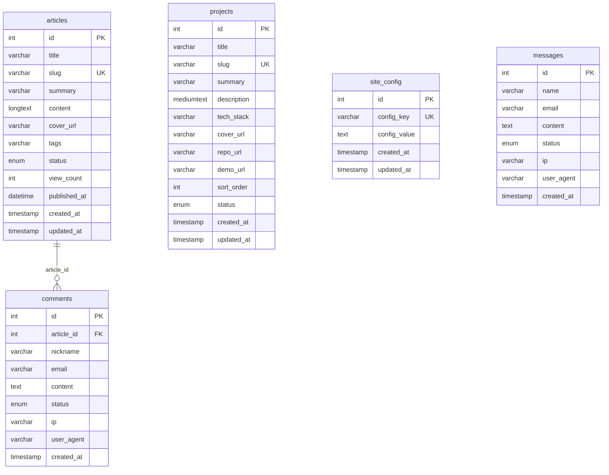

# 数据库设计（v1.1）

- **数据库**：MySQL 8.0+
- **字符集 / 排序规则**：`utf8mb4` / `utf8mb4_0900_ai_ci`（支持 emoji 与多语言，大小写不敏感）
- **存储引擎**：InnoDB（事务、行锁、外键）
- **脚本**：`database/schema.sql`（结构）、`database/seed.sql`（种子数据）

> v1.1 变更：启用 `messages` 表的写入（游客留言）。**无需修改表结构**，v1.0 已预留该表；`comments` 与阅读次数扩展点保持不变。

---

## 1. 表关系



`comments` 是 v1.0 唯一带外键的表：`comments.article_id → articles.id`，`ON DELETE CASCADE`，删除文章时评论一并清理。

---

## 2. 表结构说明

### 2.1 projects

| 字段 | 类型 | 允许空 | 默认 | 说明 |
| --- | --- | --- | --- | --- |
| `id` | INT UNSIGNED | 否 | AUTO_INCREMENT | 主键 |
| `title` | VARCHAR(120) | 否 | — | 项目名称 |
| `slug` | VARCHAR(140) | 否 | — | URL 标识，唯一 |
| `summary` | VARCHAR(300) | 否 | `''` | 卡片上的一句话简介 |
| `description` | MEDIUMTEXT | 是 | NULL | 详情正文，允许简单 HTML |
| `tech_stack` | VARCHAR(255) | 否 | `''` | 英文逗号分隔，API 输出为数组 |
| `cover_url` | VARCHAR(500) | 否 | `''` | 封面图，v1.0 允许为空 |
| `repo_url` | VARCHAR(500) | 否 | `''` | 代码仓库 |
| `demo_url` | VARCHAR(500) | 否 | `''` | 在线演示 |
| `sort_order` | INT | 否 | 0 | 越小越靠前 |
| `status` | ENUM | 否 | `draft` | `published` / `draft` |
| `created_at` | TIMESTAMP | 否 | CURRENT_TIMESTAMP | 创建时间 |
| `updated_at` | TIMESTAMP | 否 | 自动更新 | 更新时间 |

**索引**

- `uk_projects_slug(slug)`：详情页按 slug 查询，唯一约束防止重复路由。
- `idx_projects_status_sort(status, sort_order)`：列表固定 `WHERE status='published' ORDER BY sort_order`，联合索引可同时完成过滤与排序。

### 2.2 articles

| 字段 | 类型 | 允许空 | 默认 | 说明 |
| --- | --- | --- | --- | --- |
| `id` | INT UNSIGNED | 否 | AUTO_INCREMENT | 主键 |
| `title` | VARCHAR(200) | 否 | — | 标题 |
| `slug` | VARCHAR(220) | 否 | — | URL 标识，唯一 |
| `summary` | VARCHAR(400) | 否 | `''` | 摘要，列表与 SEO 描述 |
| `content` | LONGTEXT | 是 | NULL | 正文，允许简单 HTML |
| `cover_url` | VARCHAR(500) | 否 | `''` | 封面图 |
| `tags` | VARCHAR(255) | 否 | `''` | 逗号分隔标签 |
| `status` | ENUM | 否 | `draft` | `published` / `draft` |
| `view_count` | INT UNSIGNED | 否 | 0 | 阅读次数（后续统计预留） |
| `published_at` | DATETIME | 是 | NULL | 发布时间，NULL 表示未发布 |
| `created_at` | TIMESTAMP | 否 | CURRENT_TIMESTAMP | |
| `updated_at` | TIMESTAMP | 否 | 自动更新 | |

**索引**

- `uk_articles_slug(slug)`：详情查询 + 唯一约束。
- `idx_articles_status_published(status, published_at)`：列表查询 `WHERE status='published' ORDER BY published_at DESC` 走该索引，避免 filesort。
- `idx_articles_view_count(view_count)`：为后续「热门文章」排序预留。

**为什么 tags / tech_stack 不用关联表**

v1.0 的标签只用于展示，没有按标签筛选或统计的需求。用逗号分隔字段可以少两张表、少一次 JOIN。一旦需要「按标签聚合」「标签管理」，再迁移到 `tags` + `article_tags` 多对多结构，迁移路径清晰。

### 2.3 site_config

| 字段 | 类型 | 说明 |
| --- | --- | --- |
| `id` | INT UNSIGNED | 主键 |
| `config_key` | VARCHAR(100) | 唯一键，如 `contact_email` |
| `config_value` | TEXT | 值 |
| `created_at` / `updated_at` | TIMESTAMP | 审计时间 |

**当前使用的键**

| key | 用途 |
| --- | --- |
| `site_title` | 站点名称（导航、页脚、标题栏） |
| `site_description` | 主页大标题文案 |
| `profile_name` / `profile_role` | 姓名、身份 |
| `profile_bio` | 主页个人简介 |
| `profile_avatar_url` | 头像地址 |
| `profile_location` | 所在城市 |
| `contact_email` / `contact_wechat` | 联系方式 |
| `contact_note` | 联系页补充说明 |
| `social_github` / `social_zhihu` / `social_x` | 社交链接（`social_` 前缀会被自动识别） |
| `footer_text` | 页脚版权文案 |

**设计理由**：联系方式属于「会变但不常变」的配置，用 K/V 表可在不改代码、不改表结构的情况下调整。代价是类型弱、无法约束，因此后端在 `configService` 中集中做字段映射与默认值处理。

### 2.4 comments（v1.1 仍仅建表）

| 字段 | 类型 | 说明 |
| --- | --- | --- |
| `id` | INT UNSIGNED | 主键 |
| `article_id` | INT UNSIGNED | 外键 → `articles.id`，`ON DELETE CASCADE` |
| `nickname` | VARCHAR(60) | 游客昵称 |
| `email` | VARCHAR(190) | 可选，**不对外返回** |
| `content` | TEXT | 纯文本内容 |
| `status` | ENUM | `pending` / `approved` / `rejected`，默认 `pending` |
| `ip` | VARCHAR(45) | 兼容 IPv6 |
| `user_agent` | VARCHAR(500) | 截断存储，用于风控 |
| `created_at` | TIMESTAMP | |

**索引**

- `idx_comments_article(article_id)`：满足外键与基础查询。
- `idx_comments_article_status_created(article_id, status, created_at)`：详情页「某篇文章的已审核评论，按时间正序」的覆盖性更好的联合索引。

**为什么不做登录**：游客评论以「低门槛」为目标，用审核 + 限流 + 蜜罐代替账号体系。代价是无法精准溯源，因此保留 `ip` / `user_agent` 作为最低限度的风控线索。

### 2.5 messages（v1.1 启用写入）

| 字段 | 类型 | 说明 |
| --- | --- | --- |
| `id` | INT UNSIGNED | 主键 |
| `name` | VARCHAR(60) | 留言人称呼，接口限制 2–30 字符 |
| `email` | VARCHAR(190) | 选填，回复用；接口转小写，永不公开 |
| `content` | TEXT | 留言内容，接口限制 5–1000 字符，纯文本 |
| `status` | ENUM | `pending` / `read` / `archived`，新留言固定 `pending` |
| `ip` / `user_agent` | VARCHAR | 风控字段，`user_agent` 截断至 500 字符 |
| `created_at` | TIMESTAMP | |

**v1.1 写入行为**

```sql
INSERT INTO messages (name, email, content, status, ip, user_agent)
VALUES (?, ?, ?, 'pending', ?, ?);
```

- 由 `POST /api/v1/messages` 触发，无登录鉴权。
- 不提供公开读取接口；列表与审核属于后续管理端能力。
- 留言内容按纯文本存储，不做 Markdown 解析。输出到任何页面时必须转义。
- 蜜罐字段命中时不写入数据库。

留言不提供公开列表接口，避免垃圾信息与隐私泄露，因此只建了 `(status, created_at)` 索引供站主查看。

**查看与审核（v1.1 手工操作）**

```sql
-- 待审核列表
SELECT id, name, email, LEFT(content, 60) AS excerpt, created_at
FROM messages WHERE status = 'pending' ORDER BY created_at ASC;

-- 标记已读 / 归档
UPDATE messages SET status = 'read' WHERE id = ?;
UPDATE messages SET status = 'archived' WHERE id = ?;
```

**隐私建议**：`ip` / `user_agent` 只用于风控，建议保留 90 天后清空；备份与导出时对 `email` 脱敏。

---

## 3. 初始化步骤

```bash
# 1. 建库建表
mysql -u root -p < database/schema.sql

# 2. 导入种子数据
mysql -u root -p < database/seed.sql

# 3. 验证
mysql -u root -p -e "USE personal_blog; SELECT COUNT(*) FROM projects; SELECT COUNT(*) FROM articles;"
```

两个脚本都可重复执行：

- `schema.sql` 会先 `DROP TABLE`（按外键依赖倒序），**会清空数据**，仅用于本地开发。
- `seed.sql` 以 `slug` / `config_key` 为唯一键做 `ON DUPLICATE KEY UPDATE`，重复执行不会产生重复数据。

若数据库名不是 `personal_blog`，需同步修改脚本中的 `CREATE DATABASE` / `USE` 与后端 `.env` 的 `DB_NAME`。

---

## 4. 后续扩展设计

### 4.1 游客评论

已预留：表、外键、状态字段、审核索引。

实现时补充：

1. **写入**：`POST /articles/:id/comments`，服务端用 `toSafeText()` 清洗，`status` 固定 `pending`。
2. **展示**：`GET /articles/:id/comments` 仅查 `status='approved'`，不查 `email` / `ip` / `user_agent`。
3. **审核**：站主直接改 `status`，或后续加管理端。
4. **反垃圾**：IP 限流（应用层）+ 蜜罐字段 + 关键词表；量级上来后增加 `comments_spam` 或接入第三方风控。
5. **可选字段**：`parent_id`（楼中楼）、`like_count`、`deleted_at`（软删除）。

### 4.2 游客留言

v1.1 已实现写入：`POST /messages` → `messages`，`status = 'pending'`，IP 限流 + 蜜罐 + 字段校验。仍待扩展：

- **审核与查看**：管理端按 `status` 分页查询；不开放公开列表。
- **状态流转**：`pending → read → archived`，可加 `read_at`、`handled_by` 字段。
- **通知**：入库后异步发邮件给站主，失败不回滚留言。
- **反垃圾**：当前限流为进程内存计数；多实例部署改为 Redis，并视情况增加关键词过滤。
- **隐私留存**：为 `ip` / `user_agent` 增加定期清理任务（如 90 天）。
- **回复**：v1.1 通过邮箱直接回复，不在站内做会话。

### 4.3 阅读次数

v1.0 起已可用：`articles.view_count` + 原子自增 + 前端去重 + IP 限流。

要进一步做准：

```sql
CREATE TABLE article_views (
  id BIGINT UNSIGNED NOT NULL AUTO_INCREMENT,
  article_id INT UNSIGNED NOT NULL,
  visitor_hash CHAR(64) NOT NULL COMMENT 'sha256(ip + ua + 日期盐)',
  viewed_on DATE NOT NULL,
  created_at TIMESTAMP NOT NULL DEFAULT CURRENT_TIMESTAMP,
  PRIMARY KEY (id),
  UNIQUE KEY uk_article_visitor_day (article_id, visitor_hash, viewed_on),
  KEY idx_article_views_article (article_id),
  CONSTRAINT fk_article_views_article FOREIGN KEY (article_id)
    REFERENCES articles (id) ON DELETE CASCADE
) ENGINE=InnoDB DEFAULT CHARSET=utf8mb4;
```

写入流程：`INSERT IGNORE` → `affectedRows = 1` 时才 `UPDATE articles SET view_count = view_count + 1`。这样同一访客同一天只计一次，且不依赖前端 localStorage。

高并发场景再把自增改为 Redis 计数 + 定时批量回写，`view_count` 作为最终展示值。

### 4.4 其他可能的演进

- **全文检索**：`articles` 增加 `FULLTEXT(title, summary, content)` 或接入 Meilisearch。
- **文章版本**：新增 `article_revisions` 保存历史版本。
- **多语言**：新增 `locale` 字段，`slug` 唯一索引改为 `(locale, slug)`。
- **软删除**：统一加 `deleted_at`，查询条件带上 `IS NULL`。
